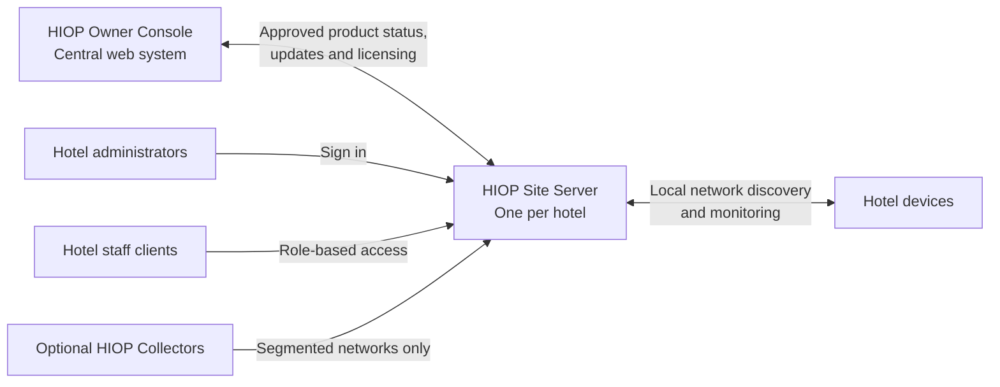

# HIOP Architecture and Deployment Guide

## Purpose

HIOP is a hospitality IT operations platform designed to run safely inside each hotel while giving the HIOP product owner a separate central view of customer installations.

The product has three layers:

1. **HIOP Owner Console**: the central web system for the HIOP product owner and approved platform administrators.
2. **HIOP Site Server**: the main HIOP installation at each hotel and the source of truth for that hotel's operational data.
3. **HIOP Clients and Collectors**: hotel users and optional network components that connect to the Site Server.

This document defines the product architecture and deployment boundaries. The delivery phases below describe the intended sequence; they do not assert that every capability is already implemented. Use the linked deployment and operations material for implementation-specific procedures.

## Architecture

## HIOP Owner Console

The Owner Console is used only by the HIOP product owner and approved platform administrators. It provides a product-level view of customer installations:

- Customer organization list.
- Installed HIOP Site Servers.
- Last check-in and installed version.
- Product access status.
- Future trial, subscription, and billing readiness.
- Aggregated product-level health.

The Owner Console does not replace a hotel's local HIOP system and does not receive detailed hotel device inventory, credentials, audit records, or operational evidence by default.

## HIOP Site Server

Each hotel has one Site Server. It is the local source of truth and provides:

- Device discovery, monitoring, and alerts.
- Asset inventory and local users and roles.
- Audit history and a local database.
- Backup and restore.
- SNMP and topology when configured.

The Site Server must continue its local operations when the hotel's internet connection is unavailable. Owner Console communication is supplementary and must not be a runtime dependency for local sign-in or hotel operations.

## HIOP Clients

Clients are hotel users who access HIOP through the desktop application or a browser on the hotel network. Examples include IT support administrators, hotel administrators, department managers with limited access, and read-only users.

Clients sign in to their hotel's Site Server and receive organization, property, and role permissions there. They do not use the HIOP Owner Console.

## Optional HIOP Collectors

A Collector is needed only when the Site Server cannot reach a separate network area, such as another building, VLAN, or secured network zone. A Collector gathers approved network evidence and sends results securely to the hotel's Site Server. It does not contain the hotel's main operational database; collection remains controlled by the Site Server.

Collectors are optional infrastructure components, not the normal desktop client experience. Use **HIOP Collector** in user-facing product language; do not call these components 'local agents' in the normal desktop experience.

## Data Boundaries

Hotel operational data remains with the hotel's Site Server by default. The Owner Console may receive only approved product-level information, such as:

- Organization name.
- Site Server status, last check-in time, and installed HIOP version.
- Product access status and aggregated health status.

Detailed device inventory, credentials, audit records, and operational evidence must not be sent to the Owner Console unless the hotel explicitly enables that sharing. Any enabled sharing must be documented, purpose-limited, and visible to the organization administrator. Product telemetry must not be treated as permission to access the Site Server.

| Data | Hotel Site Server | Owner Console by default |
| --- | --- | --- |
| Device inventory and detailed operational evidence | Stored and managed locally | Not sent |
| Credentials and encrypted secrets | Stored and managed locally | Not sent |
| Local users, roles, and audit records | Stored and managed locally | Not sent |
| Organization name and installation identity | Locally managed | Approved product-level record |
| Version, last check-in, product access, aggregate health | Locally available | Approved product-level status |

## User Roles

| Role | Responsibility |
| --- | --- |
| **HIOP Owner** | Manages the product, customer organizations, platform administrators, software releases, and future subscriptions. |
| **Organization Administrator** | Manages the hotel organization, properties, local users, roles, configuration, and local operations. |
| **IT Support** | Uses discovery, monitoring, inventory, alerts, reports, and approved device actions. |
| **Viewer** | Views permitted information without making changes. |

The Site Server is authoritative for hotel-user authorization. Owner Console platform administration does not grant hotel operational access.

## Deployment Principles

- Deploy one Site Server for each hotel as the local operational system.
- Keep the Site Server, its database, and operational backups under the hotel's deployment and recovery controls.
- Allow hotel clients to reach the Site Server over approved hotel network paths and enforce permissions at the Site Server.
- Keep local sign-in and operations available during internet outages.
- Connect to the Owner Console only for approved product-level status, updates, and licensing functions.
- Do not expose operational databases or detailed hotel data to the Owner Console as a side effect of installation registration or health check-in.
- Add a Collector only for an approved segmented network that the Site Server cannot reach directly.
- Treat restore and recovery as hotel-local procedures; verify backups before upgrades and retain a tested recovery path.

For current container, environment, upgrade, and backup commands, see [Production Deployment](../DEPLOYMENT.md) and the [Disaster Recovery Runbook](../DISASTER_RECOVERY_RUNBOOK.md). Those implementation documents may describe deployment topologies or terminology that predate this product model; validate the target installation boundary before applying them to a hotel Site Server.

## Delivery Phases

### Phase 1: Stabilize HIOP Site Server

- Rename desktop concepts to Site Server language.
- Remove confusing local-agent wording from the normal desktop experience.
- Fix sign-in persistence and local account recovery.
- Complete discovery, approval, alerts, automation, and audit filtering.
- Improve local support, backup, and recovery.

### Phase 2: Client Access

- Allow approved hotel users to connect to the Site Server.
- Enforce organization, property, and role permissions.
- Support secure local-network access.

### Phase 3: Owner Console

- Register Site Servers with the Owner Console.
- Show installation status, version, and last check-in.
- Add organization and product-access management.
- Keep hotel operational data private by default.

### Phase 4: Optional Collectors

- Add Collectors only for segmented networks.
- Provide clear Collector setup and health status.
- Keep all collection controlled by the hotel's Site Server.

### Phase 5: Commercial Readiness

- Add trial, subscription, and entitlement structure.
- Connect Stripe, Paystack, or another payment provider only when HIOP is ready for live launch.

## Supporting Documents

These existing documents provide related operational detail. They are not all dedicated, complete guides under the target names below; use the architecture and data boundaries in this document as the product-level reference.

| Supporting document | Related current material |
| --- | --- |
| HIOP Site Server Installation Guide | [Production Deployment](../DEPLOYMENT.md), [Operations](../OPERATIONS.md), and [Disaster Recovery Runbook](../DISASTER_RECOVERY_RUNBOOK.md). |
| HIOP Organization Administrator Guide | [Administrator Guide](../ADMIN_GUIDE.md) and [User Guide](../USER_GUIDE.md). |
| HIOP Owner Console Operations Guide | [Owner Console on Supabase](OWNER_CONSOLE_SUPABASE.md). |
| HIOP Security and Data Boundaries Guide | [Security Documentation](../SECURITY_DOCUMENTATION.md), [Security Report](../SECURITY_REPORT.md), and the data boundaries in this guide. |

The supporting material should be brought into alignment with the Site Server, Owner Console, and Collector terminology as each delivery phase is completed. In particular, a document or feature that still uses “local agent” terminology does not change the product boundary defined here.